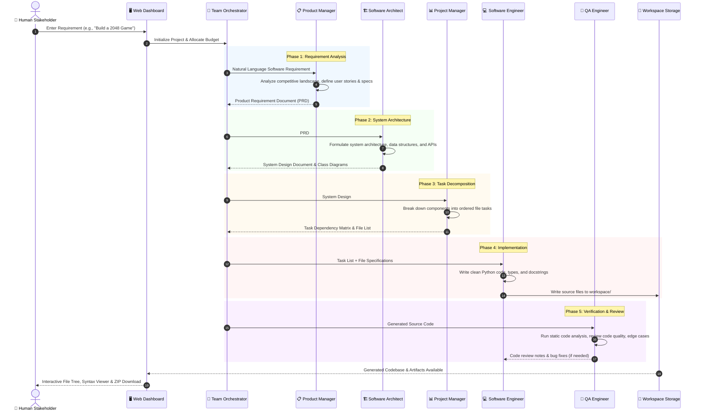

# System Architecture: AgentDev

## 1. Executive Summary

**AgentDev (A Collaborative Multi-Agent Generative AI Framework for Autonomous Software Development)** simulates an end-to-end, collaborative software development team using Large Language Models (LLMs). Rather than relying on a single monolithic prompt, this system implements **Standard Operating Procedures (SOPs)** across specialized, role-playing agents—**Product Manager**, **Software Architect**, **Project Manager**, **Software Engineer**, and **QA Engineer**—orchestrated to transform natural-language requirements into complete, validated software repositories.

---

## 2. High-Level System Architecture

The system consists of three primary layers:
1. **Presentation Layer (Web Dashboard)**: Interactive Streamlit interface providing project launch controls, live pipeline tracking, code browsing, and configuration management.
2. **Orchestration & Agent Layer**: Team coordination engine managing agent lifecycle, role-based prompting, message passing, and SOP adherence.
3. **Foundation & Provider Layer**: Asynchronous communication bus, vector store / memory buffer, file system workspace, and multi-model LLM abstraction (OpenAI, Gemini, Ollama, Groq, Anthropic).

```
┌────────────────────────────────────────────────────────────────────────┐
│                   PRESENTATION LAYER (Streamlit UI)                    │
│  [Project Launchpad]   [Live SOP Pipeline]   [Code Explorer & Zip]     │
└───────────────────────────────────┬────────────────────────────────────┘
                                    │ IPC / Subprocess Control
┌───────────────────────────────────▼────────────────────────────────────┐
│                  MULTI-AGENT ORCHESTRATION ENGINE                      │
│                                                                        │
│   ┌─────────────────────────────────────────────────────────────┐      │
│   │               Standard Operating Procedure (SOP)            │      │
│   │                                                             │      │
│   │  [Product Manager]   ──►   [Software Architect]             │      │
│   │   (PRD & User Stories)      (System Design & APIs)          │      │
│   │                                      │                      │      │
│   │                                      ▼                      │      │
│   │  [Software Engineer] ◄──   [Project Manager]                │      │
│   │   (Code Implementation)     (Task Dependency Breakdown)     │      │
│   │         │                                                   │      │
│   │         ▼                                                   │      │
│   │  [QA Engineer]       ──►   [Complete Codebase]              │      │
│   │   (Code Review & Tests)     (workspace/<project_name>/)     │      │
│   └─────────────────────────────────────────────────────────────┘      │
│                                                                        │
│   ┌─────────────────────────────────────────────────────────────┐      │
│   │           Environment & Memory Layer (Pub/Sub Bus)          │      │
│   │    • Message Pool        • Role Memory        • Context     │      │
│   └─────────────────────────────────────────────────────────────┘      │
└───────────────────────────────────┬────────────────────────────────────┘
                                    │ Async API Calls
┌───────────────────────────────────▼────────────────────────────────────┐
│                    LLM PROVIDER ABSTRACTION LAYER                      │
│     OpenAI (GPT-4o)  │  Gemini 1.5  │  Ollama (Local)  │  Groq / Claude │
└────────────────────────────────────────────────────────────────────────┘
```

---

## 3. Standard Operating Procedures (SOP) Workflow

The core engineering philosophy is **`Code = SOP(Team)`**. Each role has defined inputs, responsibilities, and structured outputs:



---

## 4. Agent Role Responsibilities

| Agent Role | Primary Class | Key Output Artifact | Objective & Function |
| :--- | :--- | :--- | :--- |
| **Product Manager** | `metagpt.roles.ProductManager` | `docs/prds/` | Deconstructs user input into a formal PRD containing user stories, competitive quadrant analysis, and functional requirements. |
| **Software Architect** | `metagpt.roles.Architect` | `docs/system_design/` | Designs architectural patterns, data flow, interface definitions, and Mermaid diagrams. |
| **Project Manager** | `metagpt.roles.ProjectManager` | `docs/tasks/` | Creates a task graph with dependency order, defining which files must be created first. |
| **Software Engineer** | `metagpt.roles.Engineer` | Source code (`*.py`, etc.) | Translates task specifications into executable code, handling imports, class logic, and algorithms. |
| **QA Engineer** | `metagpt.roles.QaEngineer` | Test reports & fixes | Conducts peer code review, checks for missing dependencies, and generates unit tests. |

---

## 5. Communication & Memory Protocol

1. **Publish-Subscribe Message Bus**:
   * Agents communicate by publishing `Message` objects to the shared `Environment`.
   * Agents subscribe to specific message types (e.g., the Architect only listens to messages published by the Product Manager).
2. **Context Isolation**:
   * Each agent maintains an isolated memory buffer containing only relevant historical messages. This prevents context contamination and token exhaustion.
3. **Schema Enforcement**:
   * Outputs from each agent are structured using Pydantic models to guarantee valid Markdown, JSON, and code syntax before being ingested by the next agent.

---

## 6. Workspace File Structure

Generated projects are stored in the `workspace/` directory with clean separation of documentation and code:

```
workspace/<project_name>/
├── docs/
│   ├── prds/                 # Product Requirement Documents
│   ├── system_design/        # Architecture & Class Diagrams
│   └── tasks/                # Task breakdowns & dependency maps
├── <source_code_files>.py    # Executable source code
└── requirements.txt          # Generated runtime dependencies
```

---

## 7. Technology Stack

* **Frontend**: Streamlit 1.67 (Python web framework with reactive UI components).
* **Agent Framework**: MetaGPT Multi-Agent Engine with custom SOP orchestrator.
* **Language Runtime**: Python 3.11.9 (64-bit).
* **Data Validation**: Pydantic v2.
* **LLM Backends**: OpenAI API, Google Gemini, Ollama (Local), Groq, Anthropic Claude.
