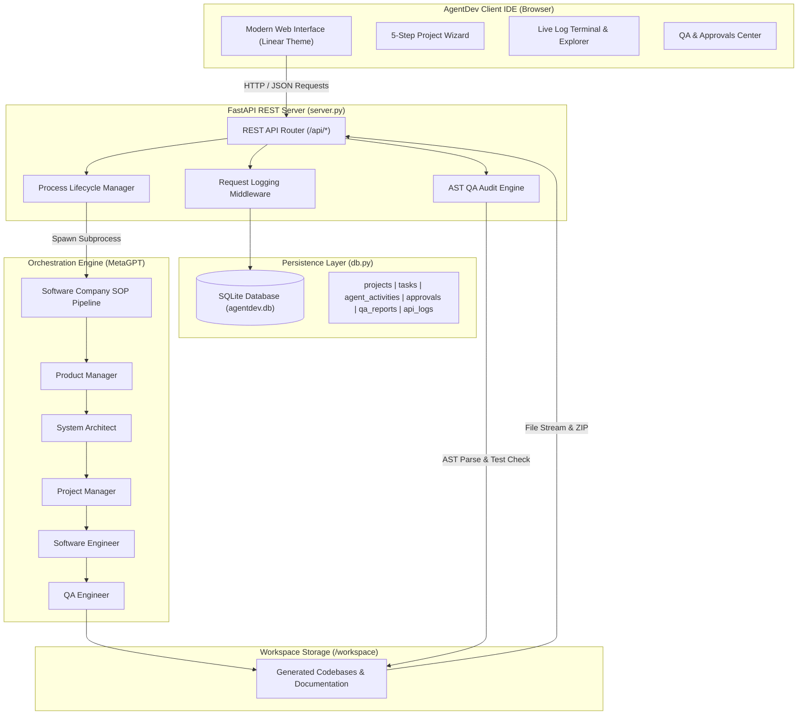

# AgentDev: A Collaborative Multi-Agent Generative AI Framework for Autonomous Software Development

> **A 6-Credit Academic Major Project & Full-Stack AI Software Engineering Platform**
>
> *"From Idea to Production, Powered by Collaborative AI."*

---

## 📌 Executive Summary

**AgentDev** is an end-to-end, full-stack autonomous software engineering platform designed to simulate the entire Software Development Life Cycle (SDLC). By orchestrating a specialized team of autonomous generative AI agents—**Product Manager**, **System Architect**, **Project Manager**, **Software Engineer**, and **QA Engineer**—AgentDev decomposes complex, ambiguous software requirements into formal specifications, software architecture diagrams, task dependency schedules, clean executable source code, and automated quality assurance audits.

The platform is architected around a genuine **Client-Server Architecture**:
1. **Backend**: An asynchronous **FastAPI REST API Server** (`server.py`) backed by an **SQLite Transactional Persistence Layer** (`agentdev.db` via `db.py`), executing MetaGPT multi-agent subprocesses, handling process lifecycle management (cancel/retry), automated AST syntax auditing, and Human-in-the-Loop review checkpoints.
2. **Frontend IDE**: A developer-grade web interface (`frontend/index.html`, `frontend/app.js`, `frontend/styles.css`) inspired by Linear, Cursor, Vercel, and modern IDEs. Features 13 views including a 5-step Project Creation Wizard, Live Monospace Log Terminal, VS Code-style File Explorer with Prism.js syntax highlighting, interactive Mermaid.js architecture diagrams, and a REST API live monitor.

---

## ✨ Core Platform Capabilities

### 1. Developer-Grade Design System
- **Linear/Vercel Aesthetic**: Deep obsidian `#07090E` theme, subtle borders (`rgba(255,255,255,0.07)`), glassmorphic panels, Lucide developer icons, and JetBrains Mono code typography.
- **Responsive Navigation**: Collapsible sidebar with active page indicators, breadcrumbs, and live backend connection telemetry.

### 2. 5-Step Project Creation Wizard
- **Step 1: Project Identity**: Name, Category (Full-Stack, Backend API, Security Tool, ML, CLI), Problem Statement, and Target Stakeholders.
- **Step 2: Specifications**: Functional and Non-Functional requirement taggers.
- **Step 3: Tech Stack**: Frameworks (FastAPI, Flask, Django, Typer), Persistence (SQLite, PostgreSQL, MongoDB), and Architecture Patterns (Clean Architecture, Microservices, MVC).
- **Step 4: Agent Team Config**: Role customization, investment budget ($3.0), and execution rounds (`n_round`).
- **Step 5: Review & Launch**: Pre-flight verification checklist and instant pipeline dispatch.

### 3. Multi-Agent Workspace (Standard Operating Procedure)
Visualizes the collaborative workflow across all 5 specialized roles:
- 📋 **Alice (Product Manager)**: `WritePRD()` → Product Requirement Document (`docs/prds/`)
- 🏗️ **Bob (Software Architect)**: `WriteDesign()` → System Design & Mermaid UML (`docs/system_design/`)
- 📊 **Eve (Project Manager)**: `WriteTasks()` → Task Dependency Breakdown (`docs/tasks/`)
- 💻 **Alex (Software Engineer)**: `WriteCode()` → Modular Executable Source Code (`*.py`)
- 🧪 **David (QA Engineer)**: `WriteCodeReview()` → Code Review, PyTest & AST Validation

### 4. Real-Time Execution Monitor & Live Terminal
- Monospace terminal with color-coded severity badges (`[ALICE:PM]`, `[BOB:ARCH]`, `[ERROR]`, etc.).
- Log search, filter by agent, filter by severity, auto-scroll toggle, and copy to clipboard.
- Live execution controls: Cancel running tasks (`POST /api/task/{id}/cancel`) and Retry failed tasks (`POST /api/task/{id}/retry`).

### 5. Code Explorer & Integrated IDE
- VS Code inspired split-pane code browser with directory tree and file size badges.
- Syntax highlighting powered by **Prism.js** for Python, JSON, Markdown, and YAML.
- One-click file copy, individual file download, and full project ZIP export (`GET /api/projects/{name}/download`).

### 6. Automated Testing & Quality Assurance Center
- Real automated AST syntax checking and unit test discovery on generated workspace repositories (`POST /api/qa/run`).
- Calculates genuine Quality Score (0–100%), syntax defect counts, and file-by-file audit diagnostics.

### 7. Human-in-the-Loop Approvals
- Review checkpoints allowing human engineers to inspect agent deliverables (PRD, Architecture, Source Code), submit feedback, and trigger approval/revision workflows (`POST /api/approvals/{id}/action`).

### 8. Live REST API Monitor & Swagger Documentation
- Route introspection table listing all registered endpoints and HTTP methods.
- Real-time HTTP request execution telemetry with millisecond latency logging.
- Direct link to FastAPI Swagger docs (`http://localhost:8000/docs`) and ReDoc (`http://localhost:8000/redoc`).

---

## 🏗️ System Architecture



---

## 🚀 Running AgentDev Locally (Windows)

### 1. Start the Full-Stack Platform (FastAPI + Modern Web IDE)

In PowerShell, start the server:
```powershell
# Using the project virtualenv
.\.venv\Scripts\python.exe -m uvicorn server:app --host 0.0.0.0 --port 8000 --reload
```

Open your browser at:
👉 **`http://localhost:8000`**

Interactive Swagger API Documentation:
👉 **`http://localhost:8000/docs`**

---

## 📡 REST API Reference

| HTTP Method | Endpoint Path | Description |
|---|---|---|
| `GET` | `/api/health` | System health check, Python runtime, LLM status |
| `GET` | `/api/dashboard/stats` | Aggregated dashboard metrics from SQLite |
| `GET` | `/api/config` | Read current LLM provider and masked key |
| `POST` | `/api/config` | Update and persist LLM configuration |
| `GET` | `/api/roles` | Metadata for the 5 specialized AI roles |
| `POST` | `/api/generate` | Launch autonomous software development pipeline |
| `GET` | `/api/task/{task_id}/status` | Poll task progress, SOP stage, and streaming logs |
| `POST` | `/api/task/{task_id}/cancel` | Terminate running subprocess |
| `POST` | `/api/task/{task_id}/retry` | Re-trigger execution pipeline |
| `GET` | `/api/projects` | List all repositories in `workspace/` and database |
| `GET` | `/api/projects/{name}/files` | Retrieve project file tree structure |
| `GET` | `/api/projects/{name}/file-content` | Retrieve raw file content (path traversal protected) |
| `GET` | `/api/projects/{name}/download` | Stream repository as compressed `.zip` archive |
| `GET` | `/api/agent/activity` | Chronological audit trail of agent operations |
| `GET` | `/api/approvals` | List Human-in-the-Loop review checkpoints |
| `POST` | `/api/approvals/{id}/action` | Approve or request revision with reviewer feedback |
| `POST` | `/api/qa/run` | Execute automated AST syntax and test audit |
| `GET` | `/api/qa/reports` | Retrieve historical QA inspection reports |
| `GET` | `/api/docs/artifacts/{name}` | Retrieve structured PRD, Design, Tasks, and README |
| `GET` | `/api/monitor/endpoints` | Introspect all registered FastAPI routes |
| `GET` | `/api/monitor/requests` | Retrieve live HTTP request execution logs & latencies |

---

## 🧪 Verification & Testing

AgentDev includes an automated verification test suite:

```powershell
.\.venv\Scripts\python.exe test_api.py
```

Expected output:
```
============================================================
RUNNING AGENTDEV BACKEND API VERIFICATION SUITE
============================================================
 PASS: /api/health                    Status: 200
 PASS: /api/dashboard/stats           Status: 200
 PASS: /api/config                    Status: 200
 PASS: /api/roles                     Status: 200
 PASS: /api/projects                  Status: 200
 PASS: /api/agent/activity            Status: 200
 PASS: /api/approvals                 Status: 200
 PASS: /api/qa/reports                Status: 200
 PASS: /api/monitor/endpoints         Status: 200
 PASS: /api/monitor/requests          Status: 200
============================================================
RESULTS: 10 PASSED, 0 FAILED
============================================================
```

To run unit tests on generated project modules:
```powershell
.\.venv\Scripts\python.exe workspace\cyber_nethra_core\test_complaint.py
```

---

## 🎓 Academic Major Project Attribution
- **Project Title**: *AgentDev: A Collaborative Multi-Agent Generative AI Framework for Autonomous Software Development*
- **Course**: 6-Credit Academic Major Project
- **Core Technology Stack**: Python 3.11, FastAPI, MetaGPT, SQLite3, Uvicorn, Tailwind CSS, Lucide Icons, Prism.js, Mermaid.js
