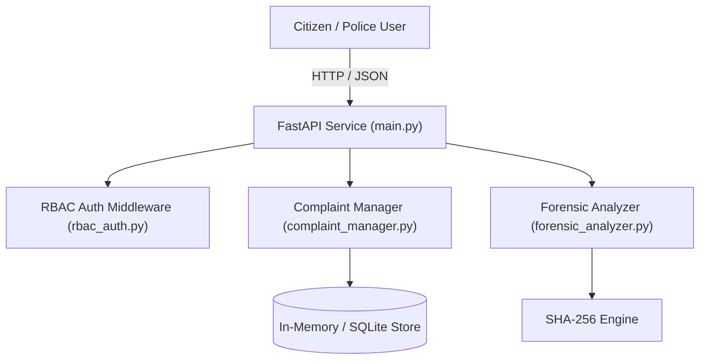

# System Architecture & Design Specification
## Project: Cyber Nethra Core
**Author: Bob (System Architect)**

### 1. System Overview
The system follows a modular Clean Architecture separating the presentation gateway (FastAPI), domain services (ComplaintManager, ForensicAnalyzer), and security layer (RBAC).

### 2. Architecture Diagram (Mermaid)

### 3. Data Structures & Interfaces
- `IncidentReport`: Stores `reference_id`, `category`, `description`, `status`, and `timestamp`.
- `EvidenceMetadata`: Stores `filename`, `sha256_hash`, `deepfake_probability`, and `integrity_status`.
